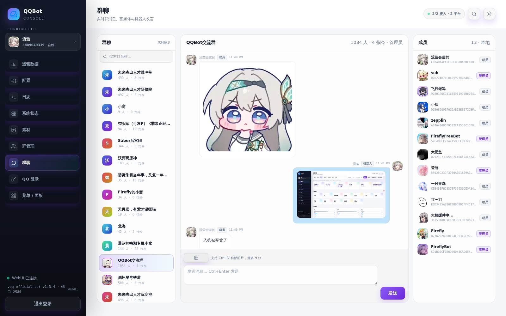
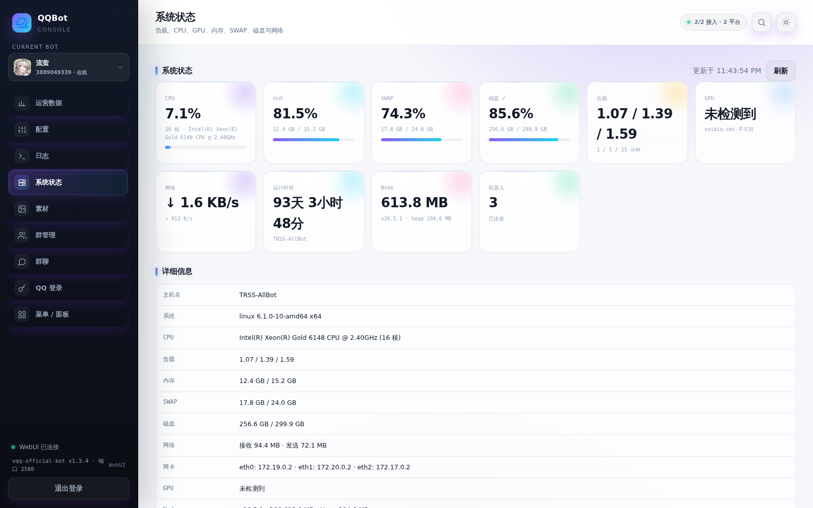

<div align="center">

# qq-official-bot-plugin

**[TRSS-Yunzai](https://github.com/TimeRainStarSky/Yunzai) 的 QQ 官方机器人适配器插件**（基于 [qq-official-bot](https://www.npmjs.com/package/qq-official-bot) 重写，兼容旧版 [QQBot-Plugin](https://github.com/TimeRainStarSky/Yunzai-QQBot-Plugin)）

[QQ 群 1046894467](https://qm.qq.com/q/WdZoPbyPsI) · [流萤QQ官方机器人](https://q.qq.com/qqbot/profile/?robot_uin=3889049339)

</div>

---

## 界面预览

> 截图来自实际运行中的 TRSS-Yunzai 容器。

<p align="center">
  
  
</p>

<p align="center">
  群聊实时消息、成员身份、引用/图片/文件卡片 · 系统负载、CPU、内存、SWAP、磁盘与网络状态
</p>

---

## 简介

本插件是 [Yunzai-QQBot-Plugin](https://github.com/TimeRainStarSky/Yunzai-QQBot-Plugin)（基于 [`qq-group-bot`](https://www.npmjs.com/package/qq-group-bot)）的**新版实现**，改用持续维护的 [`qq-official-bot`](https://www.npmjs.com/package/qq-official-bot) 1.3.4，在保留旧版配置、命令、数据目录的基础上，补上了旧版缺失的一批官方能力。

- 适配器 ID、`config/QQBot.yaml`、`data/QQBot/`、`#QQBotxxx` 命令全部沿用旧版，**可以从旧版直接迁移**
- 收发消息内部仍使用 TRSS 熟悉的扁平消息结构，仅在适配器边界转换成 `qq-official-bot` 的 `{ type, data }`
- 赠送一个功能测试插件（[example/qqbot-test.js](example/qqbot-test.js)），首次启动时自动安装到 `plugins/example/`，方便验证各项能力

## 快速开始

### 1. 准备

安装并启动 [TRSS-Yunzai](https://github.com/TimeRainStarSky/Yunzai)（Node.js **>= 20.12**）。

### 2. 安装插件

```bash
cd TRSS-Yunzai/plugins
git clone https://github.com/XingYunStar/qq-official-bot-plugin.git
cd qq-official-bot-plugin
pnpm install
```
<details>
<summary>如果在pnpm install出现 报错</summary>

```
[WARN] The "pnpm" field in package.json is no longer read by pnpm. The following keys were ignored: "pnpm.onlyBuiltDependencies", "pnpm.patchedDependencies". See https://pnpm.io/settings for the new home of each setting.
[ERR_PNPM_IGNORED_BUILDS] Ignored build scripts: sharp@0.34.5

Run "pnpm approve-builds" to pick which dependencies should be allowed to run scripts.
```
输入以下命令重新pnpm install即可解决
```bash
pnpm approve-builds sharp
pnpm install
```

</details>

**移除/停用旧的 [QQBot-Plugin](https://github.com/TimeRainStarSky/Yunzai-QQBot-Plugin)** 后重启 TRSS-Yunzai。两个插件都使用 `QQBot` 作为适配器 ID，不能同时启用；同时存在时本插件会自动跳过连接并报错。

### 3. 创建机器人

打开 [QQ 开放平台](https://q.qq.com) 创建 Bot：

1. 创建机器人
2. 开发设置 → 得到 `机器人QQ号:AppID:AppSecret`

### 4. 配置账号

输入：

#QQBot设置`机器人QQ号`:`AppID`:`AppSecret`:`是否群Bot（是1/否0/WebHook 模式 2）`:`是否频道私域（是1 否0）`


格式示例：

> 机器人QQ号 `3889012345`、AppID `102345678`、AppSecret `aBcDeFgHiJkLmNoPqRsTuVwXyZ123432`、群Bot `1`、频道私域 `0`

- WebSocket 模式（推荐）

```
#QQBot设置3889012345:102345678:aBcDeFgHiJkLmNoPqRsTuVwXyZ123432:1:0
```

- WebHook 模式（需要启用公网 HTTPS，在 `TRSS-Yunzai/config/config/server.yaml` 的 `https` 段配置证书 `key` / `cert`，并在[开放平台](https://q.qq.com)添加回调地址 `url/QQBot` ，此模式有一定的延迟）

```
#QQBot设置3889012345:102345678:aBcDeFgHiJkLmNoPqRsTuVwXyZ123432:2
```

> 已不再需要 Token。旧版 `机器人QQ号:AppID:Token:AppSecret:...` 的配置仍然兼容，Token 会被自动忽略。

<details>
<summary>群Bot / 频道私域是什么？</summary>

这两个字段对应 QQ 开放平台的 **intents（事件订阅位）**，决定平台把哪些事件推给机器人：

| 字段 | 值 | 对应 intent | 结果 |
| --- | --- | --- | --- |
| 群Bot | `1` | `GROUP_AND_C2C_EVENT`（1<<25） | 接收群 @消息、群全量消息（需群主开启）、C2C 单聊、群成员增减、入群申请等事件 |
| 群Bot | `0` | 不订阅 | 收不到群/单聊事件，表现是「机器人在群里但 @ 没反应」 |
| 群Bot | `2` | WebHook | 不建立 WebSocket，事件由开放平台回调推送 |
| 频道私域 | `1` | `GUILD_MESSAGES`（1<<9） | **私域**频道机器人，接收频道内全部消息（`MESSAGE_CREATE`） |
| 频道私域 | `0` | `PUBLIC_GUILD_MESSAGES`（1<<30） | **公域**频道机器人，只接收 @机器人 / 回复机器人的消息（`AT_MESSAGE_CREATE`） |

> 注意：`GUILD_MESSAGES` 只有私域机器人能设置；公域机器人填 `1` 可能因无权限导致 WebSocket 鉴权报错。群机器人需要机器人本身具备群能力。

官方文档：

- [事件订阅与通知 · Intents](https://bot.q.qq.com/wiki/develop/api-v2/dev-prepare/interface-framework/event-emit.html#%E4%BA%8B%E4%BB%B6%E8%AE%A2%E9%98%85intents)
- [频道消息事件](https://bot.q.qq.com/wiki/develop/api-v2/server-inter/channel/message/event.html)
- [群@机器人消息](https://bot.q.qq.com/wiki/develop/api-v2/autogen/event/group_at_message_create.html)
- [群消息（全量模式）](https://bot.q.qq.com/wiki/develop/api-v2/autogen/event/group_message_create.html)
- [单聊消息](https://bot.q.qq.com/wiki/develop/api-v2/autogen/event/c2c_message_create.html)

</details>

### 5. 发送图片 / MD 消息
<details>
<summary>不想用 MD 消息，或没有公网地址，可切换普通消息</summary>


```
#QQBotMD机器人QQ号:legacy
```

> legacy（普通消息）模式下，频道/频道私信的本地图片会走 **multipart 上传**，不需要公网地址；群聊/单聊图片本来就走上行接口，也不需要。
</details>


<details>
<summary>使用 MD 按钮消息 / MD 消息</summary>

```
#QQBotMD机器人QQ号:raw
```
或
```
#QQBotMD机器人QQ号:inline
```

> raw / inline（MD 按钮消息 / MD 消息）模式下的图片会优先通过**官方素材管理**上传，Markdown 里直接使用 `qqbot-media://` 引用，**不再需要公网地址**；如果素材接口不可用（如没有权限），才会回退到公网 URL，这时才需要下面的配置：

1. 在 `TRSS-Yunzai/config/config/server.yaml` 的 `url` 填入公网地址 **域名或 IP**（需放行 2536 端口，或反向代理到 TRSS 的内网地址），浏览器打开该地址，后台日志应出现访问请求。
2. 使用域名时，需要在宿主机把域名反向代理到 TRSS 的内网地址 `http://<TRSS内网IP>:2536`；docker 容器 TRSS 的内网 IP 可用下面命令查看（把 `TRSS` 换成你的容器名）：

   ```bash
   docker inspect -f '{{range .NetworkSettings.Networks}}{{.IPAddress}} {{end}}' TRSS
   ```

3. 如果图片加载失败，可以限制图片大小：`#QQBot图片限制2`（单位 MB，默认 3）。

> 说明：`url` 用于拼接图片等资源地址，必须是 QQ 能访问到的公网地址；只填 IP 时用 `http://IP:2536`。

`server.yaml` 示例（把域名/IP换成自己的）：

```yaml
# 服务器地址（素材上传失败时的回退地址；legacy 频道图片走 multipart 不需要）
url: http://bot.example.com
# 服务器端口
port: 2536
# 服务器缺省跳转地址
redirect: https://qm.qq.com/q/WdZoPbyPsI
# 服务器鉴权
auth: # Authorization: Bearer <access_token>

https:
  # url: https://localhost:2537
  # port: 2537
  # key: config/localhost.key
  # cert: config/localhost.crt
```
</details>

### 6. 基础命令

| 命令 | 说明 |
| --- | --- |
| `#QQBot账号` | 列出已配置账号 |
| `#QQBot设置机器人QQ号:AppID:AppSecret:是否群Bot:是否频道私域` | 添加/删除账号（是 1 否 0） |
| `#QQBot设置...:2` | 使用 Webhook 模式 |
| `#QQBotMD机器人QQ号:raw/inline/legacy` | MD按钮消息 / MD消息 / 普通消息 |
| `#QQBot图片限制2` | 图片大小限制（MB，默认 3） |
| `#QQBot重连 [QQ号]` | 手动重连 |
| `#QQBot绑定用户QQ号` | 绑定按钮回调用户 |

## 新版支持了什么

| 能力 | 说明 |
| --- | --- |
| **群内全量消息** | 支持 `GROUP_MESSAGE_CREATE`（开启「接收所有消息」后普通群消息也会派发）；按 `msg_id` 去重，只有真的 @机器人 才补自身 `at` |
| **群引用（收）** | QQ 群引用不在 `message_reference`，而在 `msg_elements`（`message_type=103`）+ `message_scene.ext`；插件会自动补 `reply` 元素、还原真实消息 ID，`e.getReply()` 可读取被引用内容 |
| **群引用（发）** | 按官方要求把 `message_reference.message_id` 转成 `msg_idx`（引用用户消息）或 `ref_idx`（引用机器人自己的消息），引用气泡正常显示；被动回复的 `msg_id` 由消息池决定 |
| **被动回复池** | 官方限制同一条群消息最多回复 5 条：插件会记录收到的群消息 ID（有效期 110 秒），发送时优先用最旧、未满 5 次的那个，避免一条消息被回复满后无法继续回复；没有有效消息时走主动消息 |
| **MD 图片素材** | 通过官方素材管理上传图片（使用**发消息的那个机器人**上传，`qqbot-media://` 与机器人绑定），Markdown 中直接引用 `qqbot-media://`，不需要公网 URL；上传后 **1 分钟自动删除未复用的图**（复用次数=0）；按 Buffer MD5 复用（记录持久化），复用次数最高的 **20 张**不会被 1 分钟清理；每天清理复用次数=0 的记录、每周只保留复用次数最高的 20 张；素材达到 **100 张**或平台返回数量上限错误时立即清空全部素材并重试；上传失败自动回退到 `server.yaml` 的 `url` |
| **群管理** | `e.group.muteMember()` 禁言、`e.group.kickMember()` 踢人、`e.group.getInfo()` 群信息、`e.group.getMemberInfo()` 成员信息；`e.member.is_admin / is_owner` |
| **群通知** | 成员进群/退群 → `notice.group.increase/decrease`；入群申请 → `notice.group.join_request`；机器人被拉群 → `notice.group.bot.increase` |
| **成员身份 / 昵称** | 优先使用消息事件 `author` / `mentions` 自带的 `member_role`、`username`，不依赖需要申请权限的「群成员详情」接口（接口报 `11253` 时自动回退） |
| **入群审批** | 通过 `qq-official-bot` 的入群申请接口查询、同意、拒绝 |
| **频道图片** | legacy（普通消息）模式支持 **multipart `file_image`** 直传，不依赖公网 URL；MD 模式优先素材上传，失败再转公网 URL |
| **URL 处理** | `toQRCode: true` 转二维码（旧行为）、`"link"` 转 Markdown 链接 `[host](url)`、`false` 原样发送 |
| **稳定性** | 断线退避重连、心跳超时探测、access_token 失败无限重试、重复连接清理、与旧插件冲突时自动跳过连接 |
| **Webhook** | 继续复用 TRSS 的 `/QQBot` 路由，签名改用 SDK 的 Ed25519（不再依赖 tweetnacl） |
| **WebUI** | 内置管理面板：配置、日志（历史/实时）、素材、群成员、运营数据；密码在日志和 `data/QQBot/webui.json` |
| **测试插件自动安装** | 首次启动把 `example/qqbot-test.js` 复制到 `plugins/example/`，并向 master 发送使用说明（单聊） |

## 配置

沿用旧版的 `TRSS-Yunzai/config/QQBot.yaml`，不需要重新配置账号。

```yaml
# 机器人QQ号:AppID:AppSecret:是否群Bot:是否频道私域
# Webhook 模式用最后一段 2：机器人QQ号:AppID:AppSecret:2
# 旧版带 Token 的格式仍兼容：机器人QQ号:AppID:Token:AppSecret:是否群Bot:是否频道私域
token:
  - 114514:102000000:xxxxxxxx:1:0

bot:
  sandbox: false        # 已废弃，新平台统一域名，保留仅为兼容
  maxRetry: .inf
  timeout: 30000

toQRCode: link          # true=二维码 / link=Markdown 链接 / false=原样
toCallback: true
toBotUpload: true
hideGuildRecall: false
imageLength: 3
autoInstallExample: true  # 首次启动把测试插件装到 plugins/example/

webui:
  enabled: true
  port: 2580
  host: 0.0.0.0

markdown:
  "114514": raw         # raw / inline / legacy / 模板ID
```

| 配置项 | 说明 |
| --- | --- |
| `token` | 账号列表：`机器人QQ号:AppID:AppSecret:是否群Bot:是否频道私域`；旧版含 Token 仍兼容 |
| `bot` | 传给 SDK 的公共配置；`sandbox` 已废弃，`maxRetry` / `timeout` 仍生效 |
| `toQRCode` | URL 处理方式：`true` 二维码、`"link"` Markdown 链接、`false` 原样 |
| `markdown` | `机器人QQ号: raw / inline / legacy / 模板ID` |
| `autoInstallExample` | 是否在首次启动时自动安装测试插件（默认 `true`） |
| `toBotUpload` | 是否把 Markdown 图片上传到官方素材（`qqbot-media://`），默认 `true` |
| `exampleGuideSent` | 是否已向 master 发送过测试插件说明（发送成功后自动置 `true`） |
| `webui` | WebUI 配置：`enabled` / `port`（默认 2580）/ `host`（默认 0.0.0.0） |
| `reconnect` | 重连/心跳参数，同旧版 |
| 其余 | `toCallback` / `hideGuildRecall` / `imageLength` / `permission` 同旧版 |

### 数据文件

- `data/QQBot/<机器人QQ号>/materials.json`：素材复用记录（MD5、复用次数、image_id）
  - 上传/复用后延迟写盘，重启后仍可复用
  - **每次连接机器人**都会读取 `lastDaily` / `lastWeekly` 时间戳，判断是否达到清理时间；到期立即清理并写回时间戳（TRSS 每天只运行 1 分钟也能触发）
  - 首次上传复用次数 = 0，每次 MD5 复用 +1
  - **1 分钟**后清理复用次数 = 0 的素材；复用过的保留
  - **每天**清理复用次数 = 0 的记录；**每周**只保留复用次数最高的 20 张
- `data/QQBot/<机器人QQ号>/refmap.ndjson`：`REFIDX` → 真实消息 ID 的引用索引
  - 收到的消息保留 **24 小时**，机器人自己发的消息保留 **7 天**
  - 每次启动时清理过期记录并原子重写；运行中每 10 分钟清理内存，按需压缩文件
  - 这样即使 TRSS 每天只运行 1 分钟，也能在启动时完成清理

## WebUI

插件启动时会在 `2580` 端口启动 WebUI（可在 `config/QQBot.yaml` 的 `webui` 中修改）：

- 地址：`http://<服务器IP>:2580/`
- 首次启动自动生成初始密码，打印在 TRSS 日志，也可在登录页点「打印密码到日志」（30 秒冷却）
- **首次登录成功后必须设置自己的密码**；设置完成后不再打印初始密码
- 功能：
  - 前端：`webui/index.html` + `webui/style.css` + `webui/app.js`（结构/样式/逻辑分离，改前端刷新即可，不用重启）
  - 配置：编辑 `config/*.yaml` 与 `config/config/*.yaml`（含 QQBot.yaml、server.yaml、other.yaml），未上线机器人也可以先配置
  - 日志：默认进入日志页即开始实时；hook 全局 `logger` 捕获所有插件日志，服务端按级别过滤并 220ms 批量推送；默认 INFO 及以上（隐藏 DEBUG/TRACE），可切全部/DEBUG/WARN/ERROR；自动把群 openid / 成员 openid 替换成短 ID + 群名/成员名
  - 系统状态：负载（1/5/15）、CPU、GPU（nvidia-smi）、内存、SWAP、磁盘、网络速率/网卡、Node 内存、运行时间、机器人数，3 秒自动刷新
  - 素材：查看/删除 Markdown 素材（`qqbot-media://`）
  - 群管理：群头像/群名/成员数、总指令数/今日指令、群内能力（管理员、主动消息、全量消息）、成员列表、禁言/解除/踢人、群黑名单
  - 群聊：仿 QQ 三栏界面，群列表/成员列表每 15 秒自动刷新（页面隐藏时暂停，没有刷新按钮），消息走 SSE 实时；聊天图片服务端缩略到 1200px 并缓存，避免超大截图解码卡顿；群头像用 q.qq.com / OneBot 群列表按群名匹配并缓存到 `data/QQBot/group-avatar-cache.json`，5 分钟尝试刷新，旧缓存不丢弃；成员昵称/头像/身份落盘 `data/QQBot/member-cache.json` 永久保存（缓存 5 分钟只用于控制读取频率，不删除旧成员）；右键成员可 @、按自定义时长禁言、解除、踢出，右键消息可复制文字/图片/链接、引用回复、撤回；@ 会去掉“机器人appid:”前缀；发送失败的消息显示红色感叹号，可点击重试；支持搜索群名、发送文本、Markdown/LaTeX（含 QQ `[#32px #32px](url)` 图片尺寸语法）、粘贴图片、选择本地图片；Markdown 附件占位符会剥离，图片/文件按卡片展示；引用消息里的 @openid 自动显示昵称（包括机器人昵称）；输入框可拖高；记录最多保留 24 小时并落盘
  - 本地群统计：按群记录消息量、指令使用量、每日趋势，保存在 `data/QQBot/group-stats.json`
  - 菜单/指令面板：自定义菜单 JSON 编辑、指令面板创建/删除，内置可用的菜单/面板示例
  - 运营数据：今天 / 昨天 / 近 7 天 / 近 14 天 / 近 30 天 / 本月 / 总览 / 自定义范围
  - 本地历史：WebUI 启动、登录和每 6 小时自动拉取官方 30 天数据并落盘 `data/QQBot/stats-history.json`，范围可以逐步超过 30 天；历史从启用本地采集后开始积累，官方不提供更早的回溯
  - 完整指标：活跃/消息/好友/群/频道、新增/回流、回复数/回复率/首回率、响应时间/轮次、用户画像（年龄/性别/地区）、群分布（分类/规模）、趋势图、全字段表格、JSON 导出
  - 前端增强：趋势图、命令面板（Ctrl+K）、日志搜索/暂停/下载、自动刷新、深色/浅色主题、移动端侧边栏

### Docker 反向代理

WebUI 监听容器内 `0.0.0.0:2580`，需要把宿主机端口反向代理到容器内 IP：

```bash
docker inspect -f '{{range .NetworkSettings.Networks}}{{.IPAddress}} {{end}}' TRSS
```

Nginx 示例：

```nginx
location /qqbot-webui/ {
    proxy_pass http://<容器IP>:2580/;
    proxy_http_version 1.1;
    proxy_set_header Host $host;
    proxy_set_header X-Real-IP $remote_addr;
    proxy_set_header Upgrade $http_upgrade;
    proxy_set_header Connection "upgrade";
    # 实时日志使用 SSE，关闭缓冲
    proxy_buffering off;
}
```

也可以直接把宿主机 `2580` 端口映射到容器 `2580`。

### QQ 开放平台登录

运营数据来自 `q.qq.com` 后台接口，需要 QQ 开放平台登录态。WebUI 支持两种方式：

**扫码登录（推荐）**

1. WebUI →「QQ 登录」→「扫码登录」
2. 手机 QQ 扫码并确认
3. 登录成功后 Cookie 自动保存，WebUI 会列出该 QQ 名下的机器人
4. 点击要查看的机器人，回到「运营数据」即可查看（支持未连接到 TRSS 的机器人）

**粘贴 Cookie**

1. 浏览器登录 https://q.qq.com ，打开开发者后台
2. F12 → Network，复制任意请求的 `Cookie` 请求头
3. WebUI →「QQ 登录」→ 粘贴 Cookie → 保存

> 官方数据接口只提供最近 7/14/30 天；本月、总览、自定义范围基于 30 天数据计算。

## 测试插件（example/qqbot-test.js）

**不会随适配器一起加载**；复制到 `plugins/example/` 后由 TRSS 作为独立插件加载。安装插件后首次启动会自动复制到 `TRSS-Yunzai/plugins/example/qqbot-test.js`（如果该文件已存在则不会覆盖，更新测试插件请手动替换）。也可以在仓库里手动下载该文件放到 `plugins/example/`。

加载后发送 `#qqbot测试` 查看全部命令：

| 命令 | 测试内容 |
| --- | --- |
| `#qqbot昵称 [@某人]` | 获取昵称（消息事件字段优先） |
| `#qqbot群名` | 获取群名（事件/缓存优先，其次群信息接口） |
| `#qqbot身份 [@某人]` | 群身份（群主/管理员/成员）、是否机器人、入群时间 |
| `#qqbotat` | `e.at` / `e.atBot` / at 元素解析结果 |
| `#qqbot引用` | 发送一条引用回复 |
| `#qqbot引用消息` | 读取被引用消息内容（支持 `msg_elements` 引用） |
| `#qqbot撤回` | 撤回测试消息；引用消息时撤回被引用那条 |
| `#qqbot连发` | 连续发送 10 条消息（测试被动回复消息池） |
| `#qqbot9MB` | 发送一张 9MB 测试图片（URL，不压缩，素材上传/大图测试） |
| `#qqbot图文` | 发送一条图文卡片消息（群聊/单聊） |
| `#qqbotwebui` | 查看 WebUI 地址和密码位置 |
| `#qqbot登录` | 查看 QQ 开放平台登录方式（WebUI 导入 Cookie） |
| `#qqbot数据 [today/yesterday/7d/14d/30d]` | 查看运营数据 |
| `#qqbot禁言 @某人 [秒数]` | 禁言，`0` 为解除（需要机器人是群管理员） |
| `#qqbot踢人 @某人 [拉黑]` | 踢人，可选加入群黑名单 |
| `#qqbot进群申请` | 待审批入群申请列表 |
| `#qqbot同意进群 [序号]` / `#qqbot拒绝进群 [序号]` | 审批入群申请 |
| `#qqbot原始` | 调试：输出本条消息的原始事件字段（`auth_token` 打码） |

权限：群管理命令要求发送者是 TRSS master 或群主/管理员；测试插件顶部有 `SKIP_PERMISSION_CHECK` 开关（默认 `false`）。

`#qqbot9MB` 使用公网图片 `https://img.likefirefly.com/image.Firefly?file=illust_116147020_20240428_011746.jpg`（约 9MB），并标记 `noCompress`，**不经过图片压缩**。

### user_id 格式与 master 配置

QQ 官方机器人拿不到真实 QQ 号，事件里给的是 **user_openid**（32 位十六进制字符串），而且是按机器人隔离的。所以适配器对外给出的 ID 是「机器人 appid + 用户 openid」：

```
114514:ABCDEF0123456789ABCDEF0123456789
```

`e.user_id`、`e.sender.user_id`、`e.group_id` 都是这个形式，**全平台统一使用冒号 `:`**。上面的 `114514` 和 `ABCDEF...` 都是示例占位，请换成你自己日志里看到的 ID。

> 旧版 Windows 曾用私用区字符 U+F03A 作分隔符，日志里不可见、配置容易对不上。现在全平台统一为 `:`；代码读取旧缓存/旧配置时仍兼容 `:`、U+F03A、`_` 三种分隔符，但新生成的 ID 一律使用 `:`。

`config/config/other.yaml` 里要写**完整的 `e.user_id`**，不是纯 openid：

```yaml
# 主人帐号（全局）
masterQQ:
  - "114514:ABCDEF0123456789ABCDEF0123456789"

# Bot账号:主人帐号（值仍是完整的 e.user_id）
master:
  - "114514:114514:ABCDEF0123456789ABCDEF0123456789"
```

不知道自己的 ID 就给机器人发一条消息，看日志里的 `好友消息：[<机器人appid>:<你的openid>]`，或发 `#qqbot原始` 查看事件字段；也可以先在群里用 `#QQBot绑定用户` 绑定。发送单聊通知时适配器会自动剥掉 appid 前缀，所以 `master` 写成纯 openid 也能收到通知，但**权限判定仍以完整 `e.user_id` 为准**。

> 如果你的旧数据来自 Windows 版的 U+F03A 分隔符，适配器可以读取，但建议把 `master` 配置改成上面的冒号格式，避免复制粘贴时不可见字符再次出错。

### master 单聊通知

首次自动安装（或首次启动且尚未发送过）时，插件会向 **master** 发送一条单聊使用说明，发送成功后写入 `exampleGuideSent`，之后不会重复打扰。master 来自 `config/config/other.yaml`（按机器人 ID 分组），写法见上一节。

找不到可用 master 时只会输出一条 warn 日志，不影响使用。

## 与旧版的差异

- SDK：`qq-group-bot` 1.1.0（停更）→ `qq-official-bot` 1.3.4（持续维护）
- 域名：`api.sgroup.qq.com` → `api.bot.qq.com`（`sandbox` 已废弃）
- 配置：不再需要 Token，格式为 `机器人QQ号:AppID:AppSecret:...`；旧版含 Token 的配置仍可识别（Token 被忽略）
- Intents：`GROUP_AT_MESSAGE_CREATE` + `C2C_MESSAGE_CREATE` 合并为 `GROUP_AND_C2C_EVENT`
- Webhook：仍是 `/QQBot` 单路由，签名改用 Ed25519
- 频道/频道私信图片：legacy（普通消息）模式走 multipart `file_image` 上传，不需要公网 URL；MD 模式优先走官方素材上传（`qqbot-media://`），失败才回退公网 URL
- 被动回复：不再固定回复触发消息，而是用 110 秒内最旧的群消息 ID，单条消息最多回复 5 次
- 引用索引：`REFIDX → 真实消息 ID` 持久化到 `data/QQBot/<机器人QQ号>/refmap.ndjson`，重启后仍可解析
- 消息元素：插件内部仍是扁平结构，收发边界自动转换，对上层透明

## 已知限制

- 「群成员详情」接口需要开放平台权限，未申请时返回 `11253`；身份/昵称会回退到消息事件字段
- 撤回别人的消息需要机器人有相应权限（如群管理员），是否成功以平台返回为准
- 改动前没有记录过的旧消息，平台只给 `REFIDX` 索引，无法还原真实消息 ID；新消息会持久化（收 24h / 发 7 天）
- 同一条群消息最多回复 5 条；插件会用 110 秒内的其它消息 ID 续接，长时间没有新消息时只能走主动消息（受主动消息配额限制）
- 素材上传需要开放平台相应接口权限，失败时会自动回退公网 URL
- 群内全量消息需要在群设置中由群主开启「接收所有消息」

## 测试

```bash
npm test
```

离线集成测试：用桩替代 TRSS 框架与网络，但使用真实的 `qq-official-bot` 解析和真实插件代码，覆盖连接、消息解析、全量消息、群引用收发、元素转换、频道 multipart、被动回复消息池、Markdown 素材上传、引用索引持久化、群管理 API、通知、自动安装、master 说明、重连、冲突保护等（168 条断言）。

## 致谢

- 旧版插件作者：[时雨🌌星空](https://github.com/TimeRainStarSky/Yunzai-QQBot-Plugin)
- SDK：[qq-official-bot](https://github.com/zhinjs/qq-official-bot)（凉菜）
- QQ 群：[1046894467](https://qm.qq.com/q/WdZoPbyPsI)
